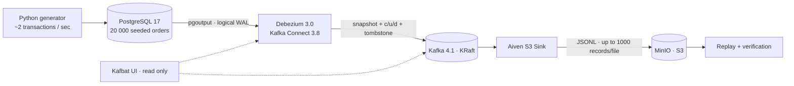

# PostgreSQL → Kafka → S3 · CDC Pipeline

**CDC** воспроизводимый конвейер Change Data Capture,
проверка доставки изменений и практические эксперименты с отказами.


Изменения заказов интернет-магазина передаются из WAL PostgreSQL в Kafka
через Debezium, затем сохраняются в S3-совместимый MinIO как JSON Lines.
Первый запуск делает snapshot существующих заказов; последующие изменения
приходят непрерывно. JSONL сохраняет ключ, значение, offset и timestamp.
Отдельный replay восстанавливает состояние заказов из файлов и сверяет его
с PostgreSQL после остановки генератора.



## Что демонстрирует проект

- Настройку логической репликации: `wal_level`, публикации, слоты и `REPLICA IDENTITY FULL`.
- Snapshot и поток `INSERT / UPDATE / DELETE`, включая `before`, `after` и tombstone.
- Раздельные позиции source и sink, consumer lag, удержание WAL и action heartbeat.
- Доставку в S3, проблему маленьких файлов и изменение схемы без остановки потока.
- Отдельный поток Parquet с Kafka Connect schema/payload и unwrap.
- Compaction справочника остатков, безопасное удаление осиротевших слотов.
- Восстановление состояния, обработку повторных offsets и сквозную проверку данных.

## Быстрый старт

Нужны Docker Desktop с **Linux containers**, Docker Compose v2 и Python **3.12+**.
Выделите Docker ориентировочно 6–8 ГБ RAM и 8 ГБ свободного места.
Первой сборке нужен интернет; Kafka, Java-плагины и MinIO собираются/скачиваются.
Полная первая сборка, включая MinIO из Go-исходников, может занять 10–20 минут.
Python-библиотеки хоста устанавливать не требуется: инструменты работают в контейнере.

В PowerShell, Bash или терминале IDE, из корня проекта:

```sh
python cdc.py init
python cdc.py up
python cdc.py demo
```

`init` создаёт `.env` из примера, сохраняя существующий файл. `up` дожидается
готовности инфраструктуры, создаёт бакет и регистрирует оба коннектора.
`demo` отправляет контрольный заказ, обновляет и удаляет его; проверяет
`c → u → d → tombstone` в Kafka **и** JSONL в MinIO, наличие snapshot и before image;
затем выводит пример файла и диагностику. Отчёт сохраняется в `artifacts/verification.json`.

| Интерфейс     | Адрес                            | Что смотреть                                               |
| ------------- | -------------------------------- | ---------------------------------------------------------- |
| Kafka UI      | http://localhost:8080            | `cdc.shop.orders`, группа `connect-orders-s3-sink`, задачи |
| MinIO console | http://localhost:9001            | Бакет `cdc-lake`, JSONL-файлы                              |
| Kafka Connect | http://localhost:8083/connectors | REST API коннекторов                                       |
| PostgreSQL    | `localhost:5432`, база `shop`    | Схема `shop`, роль `cdc`                                   |

Демо-логин MinIO — `cdc-demo`, пароль — `local-minio-demo` из `.env.example`.
Пароль PostgreSQL для роли `cdc` — значение `CDC_PASSWORD` в `.env`.
Все внешние порты привязаны к `127.0.0.1`; занятый порт можно заменить в `.env`.

## Данные и результат

База содержит 1 000 покупателей, 100 товаров и 20 000 синтетических заказов.
Генератор делает примерно две транзакции в секунду: вставки, обновления
и удаления. Удаления и обновления не затрагивают контрольные заказы проверки.

Путь объекта:

```text
s3://cdc-lake/cdc.shop.orders/0/00000000000000000000.jsonl
```

Пример формы строки, приведённый для иллюстрации:

```json
{
	"key": { "order_id": 42 },
	"value": {
		"before": null,
		"after": { "order_id": 42, "status": "new" },
		"op": "c",
		"source": { "schema": "shop", "table": "orders" }
	},
	"offset": 20000,
	"timestamp": "2026-10-04T12:00:00Z"
}
```

Таблица и её CDC-журнал имеют разный смысл: JSONL сохраняет историю изменений.
Количество событий не равно числу текущих заказов. После `DELETE` Debezium
отправляет событие `d` и отдельную запись с тем же ключом и `value: null`.

## Основные команды

```sh
python cdc.py status                     # задачи, слоты, WAL, публикации, S3
python cdc.py inspect --limit 2           # содержимое последних файлов
python cdc.py verify                     # новая сквозная проверка
python cdc.py replay --compare           # остановить генератор, дождаться доставки, сравнить
python cdc.py generator start            # возобновить генерацию после сравнения
python cdc.py scenario pause-sink         # накопить consumer lag
python cdc.py scenario resume-sink        # догнать поток
python cdc.py scenario schema             # добавить channel и заказ с channel=mobile
python cdc.py scenario parquet            # отдельная пара source/sink, проверка Parquet
python cdc.py scenario heartbeat          # отдельный idle source с action heartbeat
python cdc.py scenario orphan             # оставить слот после удаления тестового source
python cdc.py scenario compaction         # 100 ключей, тысячи обновлений, закрытие сегментов
python cdc.py cleanup                     # убрать дополнительные коннекторы, слоты, публикации
python cdc.py logs connect
python cdc.py down                       # остановить; данные в volumes сохраняются
```

`replay --compare` сравнивает множество ключей и бизнес-поля заказов.
Timestamp-поля представлены по-разному в PostgreSQL и Debezium, поэтому
они не участвуют в этой сверке. Новые поля сохраняются в восстановленном JSON.
Результат — `artifacts/replay.json` и `artifacts/orders-state.json`.

Подробные шаги экспериментов: [docs/lab-guide.md](docs/lab-guide.md).
Решения и ограничения: [docs/architecture.md](docs/architecture.md).
Диагностика: [docs/troubleshooting.md](docs/troubleshooting.md).
Подготовка GitHub-репозитория: [docs/github.md](docs/github.md).
Проверки этой локальной реализации: [docs/validation.md](docs/validation.md).

## Проверки

Локально проверены доставка snapshot/INSERT/UPDATE/DELETE, изменение схемы,
Parquet и восстановление **20 635 заказов без расхождений** с PostgreSQL.
Фактические отчёты: [результаты проверки](docs/validation.md).

Без Docker и сторонних Python-библиотек:

```sh
python -m unittest discover -s tests -v
```

В работающем стенде:

```sh
python cdc.py verify
python cdc.py replay --compare
```

GitHub Actions запускает unit-тесты и проверку Compose на push/PR.
Полный integration job доступен вручную через **Actions → Checks → Run workflow → integration**.
Он собирает инфраструктуру, проверяет доставку и replay, сохраняет отчёты и логи.

## Воспроизводимость и границы

Это локальный учебный стенд с одним брокером, RF=1 и одной партицией основного
топика. TLS, HA, Schema Registry, IAM и инфраструктура production здесь не реализованы.
Порядок гарантируется внутри партиции; полагаться на глобальный порядок нескольких
партиций нельзя. В условиях повторной доставки потребителю нужна идемпотентность.

Worker выгружает данные каждые 10 секунд; `file.max.records=1000` задаёт верхний
предел файла. При ~2 транзакциях/с файлы будут значительно меньше 1 000 записей.
Это осознанная настройка для наблюдаемого демо, а не оптимальный режим большого data lake.

MinIO собирается из официальных исходников версии `RELEASE.2025-04-22T22-12-26Z`:
готовые исторические образы недоступны в исходных реестрах. Версии прямых Python-зависимостей
и плагинов фиксированы. Эта фиксация не означает актуальность исправлений для production.

Полный сброс **удаляет только volumes этого Compose-проекта**:

```sh
python cdc.py reset --yes
python cdc.py up
```

Изменение паролей `.env` после инициализации PostgreSQL не меняет пароль
существующей роли в volume: примените `ALTER ROLE` либо явно сбросьте стенд.

## Происхождение и лицензия

Самостоятельная локальная реализация по учебным материалам
`rzv_de-kafka-cdc-materials.pdf`, дополненная автоматизацией, replay и тестами.
Материалы исходной платформы и PDF не включены в репозиторий.
Код — [MIT](LICENSE); сторонние компоненты сохраняют собственные лицензии,
включая AGPLv3 у MinIO: [THIRD_PARTY_NOTICES.md](THIRD_PARTY_NOTICES.md).

Первичные источники: [Debezium PostgreSQL](https://debezium.io/documentation/reference/3.0/connectors/postgresql.html),
[Aiven S3 connector](https://github.com/Aiven-Open/cloud-storage-connectors-for-apache-kafka/tree/v3.4.3/s3-sink-connector),
[Kafka Connect](https://kafka.apache.org/38/documentation/#connect),
[MinIO source](https://github.com/minio/minio/tree/RELEASE.2025-04-22T22-12-26Z).
